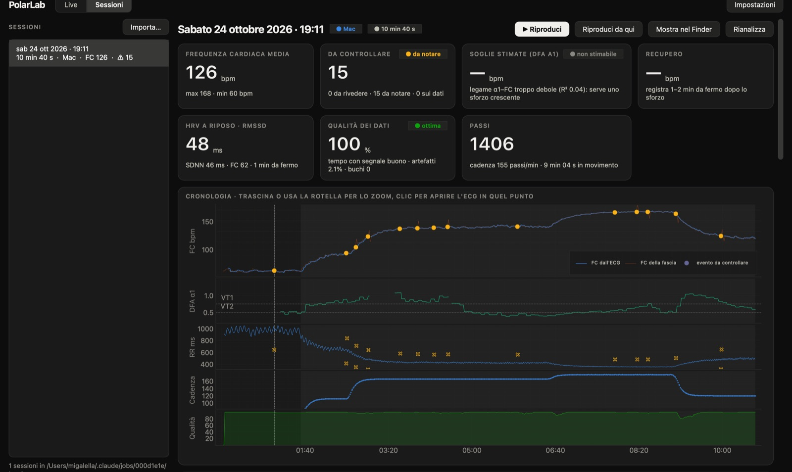
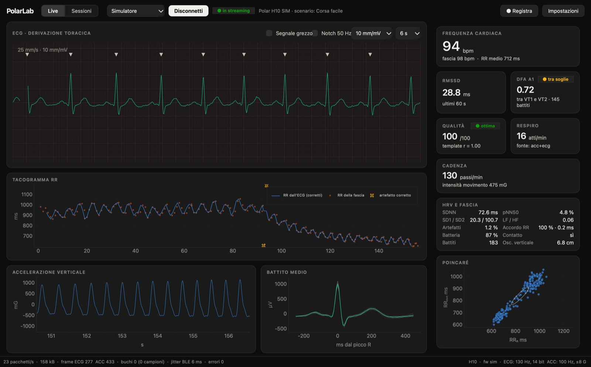
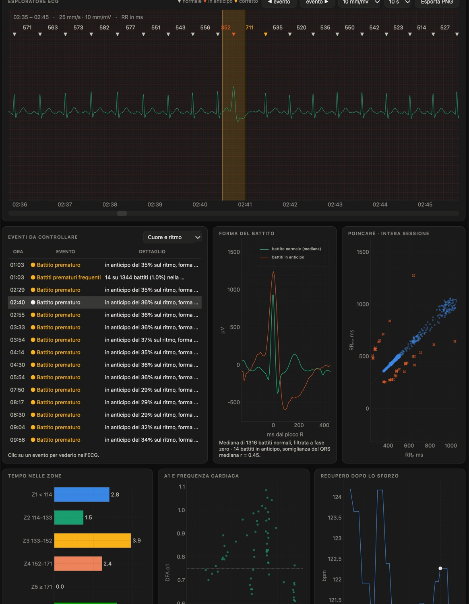

# PolarLab

Real-time streaming and analysis of the **raw ECG from a Polar H10** chest strap, with a
macOS app for live monitoring and post-run analysis and an iPhone app for recording while you
run.

- **Mac** (Python, PySide6): live ECG monitor, session archive, and a single-screen
  analysis of each run, focused on the heart.
- **iPhone** (Swift, SwiftUI): a minimal screen that records everything the strap sends
  (ECG, beats, accelerometer) in the background, and lets you share the session to the Mac.
- **Same engine on both**: Bluetooth protocol, algorithms and file format were written in
  Python first and then ported 1:1 to Swift. Both versions produce the same beats, RR intervals and
  metrics on the same recording.



> PolarLab is an experimental training tool, **not a medical device**. A chest strap records
> a single ECG lead and cannot replace a clinical ECG. The app's "events to review" are
> pointers for looking at the trace, not diagnoses.
>
> The user interface is currently in **Italian**. The code, the file formats and this
> documentation are in English.

## Contents
- [Features](#features)
- [Requirements](#requirements)
- [Mac: install and run](#mac-install-and-run)
- [iPhone: install](#iphone-install)
- [Typical workflow](#typical-workflow)
- [Session analysis](#session-analysis)
- [Recordings](#recordings)
- [Project layout](#project-layout)
- [Tests](#tests)
- [Further documentation](#further-documentation)

## Features

### Live monitor (Mac)


- **Raw ECG at 130 Hz** on a sweeping monitor with ECG-paper grid (25 mm/s, 10 mm/mV) and R peaks marked
- **Heart rate** from our own QRS detector, side by side with the strap's value
- **HRV**: RMSSD, SDNN, pNN50, Poincaré SD1/SD2, LF/HF, RR tachogram with corrected artefacts
- **DFA α1** (2-minute window) with aerobic/anaerobic threshold zones
- **Average beat** (P-QRS-T morphology) and a 0–100 **signal quality** score
- **Breathing rate** (from ECG and accelerometer), **cadence**, **vertical oscillation**, motion intensity
- Battery, electrode contact, packets per second, stream gaps, Bluetooth jitter
- Sources: the real strap, a byte-exact **simulator** (no strap needed), or **replay** of a recorded session

### Session archive and analysis (Mac)


- A **Sessions** page lists every recording. It reads only small metadata files; the data of a
  session are loaded only when you select it, in a background thread, and cached on disk.
- **Import** the zip shared from the iPhone: drag it onto the window or onto the Dock icon,
  or use *Importa…*. PolarLab also spots new `PolarLab_*.zip` files in Downloads.
- **One overview screen per run**:
  - summary tiles: average/max/min HR, estimated VT1/VT2 heart rate from DFA α1, heart rate
    recovery, resting HRV, data quality, steps and cadence;
  - a **timeline** with a shared time axis (HR, α1, RR, cadence, signal quality), zoomable;
  - an **ECG explorer** over the whole session on ECG paper, with R peaks coloured by type and
    the RR interval in ms over every beat. You can export the visible strip as PNG;
  - **events to review**: premature beats (with QRS shape compared to your normal beat), pauses,
    very high heart rate, abrupt HR jumps, irregular rhythm under effort, data gaps, lost contact.
    Click an event to see it in the ECG;
  - average beat vs premature beats, whole-session Poincaré plot, time in HR and α1 zones,
    α1-vs-HR regression, recovery curve, recording details.
- **Replay** any session in the live monitor, from the start or from the point shown in the
  ECG explorer, at ×1 to ×16 speed.
- **Re-analyse**: the raw Bluetooth log is the source of truth, so improved algorithms can be
  re-applied to every past run.

### iPhone app
- Connects to your H10, remembers it and reconnects automatically
- **Auto-records** as soon as the strap streams, also with the screen off (`bluetooth-central`
  background mode). It closes the session after 10 minutes without data.
- Session list with summary and charts. *Share* creates a zip for the Mac.
- Built to save battery: no GPS, no drawing with the screen off, writes to disk every 10 s

## Requirements
- A **Polar H10** chest strap (firmware 5.x tested)
- **Mac**: macOS 13 or later with Bluetooth, and **Python 3.13** (Homebrew recommended:
  `brew install python@3.13`)
- **iPhone**: iOS 17 or later, and a free Apple ID for sideloading

## Mac: install and run

```bash
git clone https://github.com/michelinot99/PolarLab.git
cd PolarLab
python3.13 -m venv venv.nosync
venv.nosync/bin/pip install -r requirements.txt
```

### As a real Mac app (recommended)
```bash
scripts/build_mac_app.sh          # installs /Applications/PolarLab.app (or ~/Applications)
```
This builds a small **launcher app** with its own name, icon and Bluetooth permission. It
always runs the Python code in this folder with `venv.nosync`, so after a `git pull` you just
reopen it. Rebuild it only if you move the project folder or upgrade to a new Python minor
version. Logs go to `~/Library/Logs/PolarLab/polarlab.log`.

<details>
<summary>Why a compiled launcher instead of a shell script?</summary>

Homebrew's Python is a "framework" build that relaunches itself as `Python.app`. With a
script, the Dock would show "Python", and macOS would ask for Bluetooth access on behalf of an
`Info.plist` that does not declare `NSBluetoothAlwaysUsageDescription`. The launcher
(`macos/launcher.c`) embeds libpython instead, so the process *is* PolarLab.app.
</details>

### From the terminal
```bash
venv.nosync/bin/python -m polarlab                 # pick the source in the toolbar
venv.nosync/bin/python -m polarlab --sim           # simulator, no strap needed
venv.nosync/bin/python -m polarlab --h10           # connect to the strap right away
venv.nosync/bin/python -m polarlab --replay sessions/2026-10-22_183015 --speed 4
venv.nosync/bin/python -m polarlab --open-session sessions/2026-10-22_183015
```
Or double-click `Avvia_PolarLab.command`.

> **Why `venv.nosync` and not `.venv`?** If the project lives in an iCloud-synced folder
> (Desktop, Documents), iCloud marks everything inside dot-folders as hidden, and Qt on macOS
> skips hidden plugins, so the app would not start. The `.nosync` suffix also keeps ~1 GB of
> libraries out of iCloud.

### First connection to the strap
1. Wet the electrodes and put the strap on: the H10 only wakes up on skin contact.
2. Close Polar Beat/Flow on your phone and unpair any watch using the strap: the ECG stream
   accepts **one client at a time**.
3. Optional diagnostics:
   ```bash
   venv.nosync/bin/python scripts/probe_h10.py --seconds 30 --save
   ```
   The first time, macOS asks for Bluetooth permission. The script prints the GATT services,
   firmware, MTU, PMD settings, effective sample rate, lost packets, and how well our RR
   intervals agree with the strap's.
4. In the app choose **Polar H10** → **Connetti** (Connect). With **Fascia: …** you can pin
   your own H10 so the app never connects to someone else's.

## iPhone: install

The iPhone app is in [`ios/`](ios/). Apple only allows installing your own apps outside the
App Store with a developer signature. A **free Apple ID** works, but the install expires
after **7 days** and has to be refreshed (your recordings stay on the phone).

Choose one of these:

| Method | What you need | Refresh every 7 days |
|---|---|---|
| **Xcode** | Mac with Xcode, cable | Press ▶︎ in Xcode again |
| **AltStore** | AltServer on the Mac, AltStore on the iPhone, an `.ipa` | Automatic over Wi-Fi when AltServer is running |
| **Sideloadly** | Sideloadly on the Mac, an `.ipa` | Re-install with Sideloadly |

**Getting an `.ipa` without Xcode**: every push that touches `ios/` runs the
[*iPhone* GitHub Actions workflow](.github/workflows/ios.yml). It builds an **unsigned**
`PolarLab.ipa` on a GitHub-hosted Mac and attaches it to the run as the `PolarLab-ipa`
artifact. AltStore and Sideloadly sign it with your Apple ID during installation. To download
it, sign in to GitHub, go to *Actions → iPhone → latest run → Artifacts*, or use:
```bash
gh run download -R michelinot99/PolarLab -n PolarLab-ipa
```
If you use a fork, run the workflow there (*Actions → iPhone → Run workflow*).

**With AltStore**: connect the iPhone, then ⌥-click the AltServer menu-bar icon →
*Sideload .ipa…* → choose your iPhone and `PolarLab.ipa`. On the iPhone, turn on
*Settings → Privacy & Security → Developer Mode* and, if asked, trust your Apple ID under
*Settings → General → VPN & Device Management*.

Full instructions, including the Xcode route: [ios/README.md](ios/README.md).

## Typical workflow
1. Put the strap on and open PolarLab on the iPhone. Recording starts by itself.
2. Run. You can lock the phone.
3. Stop the session (or just stop moving: it closes after 10 minutes without data).
4. Open the session on the iPhone → **Condividi** (Share) → AirDrop to the Mac.
5. Drag the zip onto PolarLab, or onto its Dock icon. The session appears in **Sessioni** with
   its analysis.

Sessions recorded on the Mac (**● Registra**) appear in the archive automatically.

## Session analysis
Selecting a session re-processes its raw log with the current decoder and engine, the same
ones that run live. It then adds whole-session analyses on top. Results are cached in the
session folder (`analysis.npz`, `analysis.json`) until the raw log or the analysis version
changes.

| Section | What you get |
|---|---|
| Heart rate | average, minimum and maximum (5-s rolling median, so spikes don't count), ECG vs strap HR over time, time in 5 zones (set your max HR in *Impostazioni*, plus resting HR for Karvonen zones) |
| Thresholds | DFA α1 over time; minutes in α1 zones; **HR at VT1 (α1 = 0.75) and VT2 (α1 = 0.5)** from an α1-vs-HR regression (Rogers et al. 2021), shown only when the relationship is clear (R² ≥ 0.3), and flagged "reliable" when R² ≥ 0.5 and the threshold falls inside the observed values |
| Effort | moving segments detected from the accelerometer, steps, cadence, vertical oscillation, cardiac drift (2nd vs 1st half of the longest steady segment ≥ 20 min) |
| Recovery | HR drop 30, 60 and 120 s after the peak at the end of the last effort, with the curve |
| HRV | RMSSD/SDNN in the still minutes before the first movement; RMSSD while moving; whole-session Poincaré |
| Events to review | premature beats (short-long RR pattern from the Lipponen–Tarvainen classifier, with the QRS correlation against your median normal beat), runs of premature beats, frequent premature beats (≥ 1% of beats), pauses (RR > 2 s), very high HR (above your max + 5, or 200 bpm, for ≥ 10 s), abrupt HR jumps (> 30 bpm in 5 s without a change in movement), irregular rhythm under effort (HR > 100 with ≥ 25% of consecutive beats differing by more than 8%), data gaps, lost contact, poor signal |

The methods, thresholds and their limits are described in [docs/ANALYSIS.md](docs/ANALYSIS.md).

## Recordings
Every session is a folder `sessions/YYYY-MM-DD_hhmmss/`:
- `raw.plab`: every Bluetooth packet exactly as it arrived. **This is the source of truth.**
- `meta.json`: device, firmware, stream settings, statistics (and a summary on iPhone).
- `ecg.csv`, `acc.csv`, `hr.csv`, `beats.csv` (RR, corrected NN, artefact type), `metrics.csv` (1 Hz).
- `analysis.npz`, `analysis.json`: the Mac analysis cache (regenerated when needed).

The CSV files are regenerated from the raw log, so when an algorithm improves it can be applied
to all past runs (**Rianalizza** in the app). The `sessions/` folder is git-ignored: your
recordings stay on your Mac.

`raw.plab` format: header `b"PLAB\x01\n"`, then records `<f8 host_t> <u1 channel> <u2 length> <bytes…>`
(little-endian). See [polarlab/core/session.py](polarlab/core/session.py).

## Project layout

```
polarlab/
  protocol/   bytes → structures, no I/O (PMD, Heart Rate Service, timestamps, decoder)
  sources/    real strap (bleak/CoreBluetooth), byte-level simulator, replay
  dsp/        filters, QRS, RR correction, HRV, DFA, quality, average beat, motion, breathing
  core/       analysis engine, threaded pipeline, recording and re-processing
  analysis/   whole-session report: thresholds, recovery, events to review, cache
  ui/         PySide6 + pyqtgraph: live monitor, sessions archive, analysis screen
macos/        launcher and Info.plist for PolarLab.app
ios/          iPhone app (SwiftUI) and PolarKit, the Swift port of the engine
scripts/      build_mac_app.sh, probe_h10.py (diagnostics), validate_qrs.py (MIT-BIH),
              compare_swift.py (Python vs Swift on the same recording)
tests/        protocol byte vectors, DSP, pipeline end-to-end, session analysis
docs/         PROTOCOL.md, ALGORITHMS.md, ANALYSIS.md, IOS_PORTING.md
```

The simulator generates **the same bytes as the H10**. Decoder, DSP, recording, analysis and
UI can all be exercised without wearing the strap. Its scenario goes from rest to walking,
easy running, threshold pace and cool-down, and includes ectopic beats.

## Tests

```bash
venv.nosync/bin/python -m pytest -q
venv.nosync/bin/python scripts/validate_qrs.py 100 105 203   # needs wfdb, downloads from PhysioNet
```
Swift port checks (no Xcode needed) are in [ios/README.md](ios/README.md#verification-without-xcode).

## Further documentation
- [docs/PROTOCOL.md](docs/PROTOCOL.md): the H10 Bluetooth protocol (GATT, PMD, frame formats, timestamps)
- [docs/ALGORITHMS.md](docs/ALGORITHMS.md): filters, QRS detection, artefact correction, HRV, DFA α1, quality, breathing, motion
- [docs/ANALYSIS.md](docs/ANALYSIS.md): the whole-session analysis and the events to review
- [docs/IOS_PORTING.md](docs/IOS_PORTING.md): how the Python code maps to Swift
- [ios/README.md](ios/README.md): the iPhone app, installation and verification
